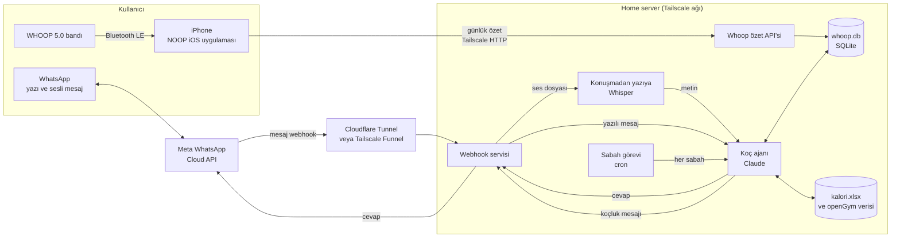

# Ultimate Healt Tracker

WHOOP bandından, kalori takibinden ve antrenman kayıtlarından gelen verileri tek yerde toplayan, sesli mesajla konuşulan ve her sabah yapay zekâ koçluğu yapan kişisel sağlık sistemi.

Bu doküman sadece neyin nasıl kurulacağını anlatan bir rehberdir. Henüz kod içermez.

## 1. Hedef

- WHOOP aboneliği ödemeden bandın verisini kullanmak
- Kalori, antrenman ve WHOOP verisini tek veritabanında birleştirmek
- WhatsApp'tan yazarak veya sesli mesaj atarak yemek ve antrenman kaydı girmek
- Her sabah toparlanma, uyku, kalori ve antrenman durumuna göre kişisel koçluk mesajı almak
- Tüm veriyi kendi home server'ında tutmak

## 2. Genel şema

## 3. Bileşenler

| Bileşen | Görevi | Nerede çalışır |
|---|---|---|
| WHOOP 5.0 bandı | Kalp atışı, HRV, SpO₂, cilt sıcaklığı, uyku verisini toplar | Bilekte |
| NOOP | Bandla Bluetooth üzerinden eşleşir, skorları cihazda hesaplar | iPhone (iOS portu), geçici olarak Mac veya Android |
| Whoop özet API'si | iPhone'dan gelen günlük özeti alıp kaydeder | Home server |
| whoop.db | Günlük toparlanma, zorlanma, uyku, HRV, dinlenme nabzı | Home server |
| kalori.xlsx ve openGym | Yemek, kalori, antrenman set kayıtları | Home server |
| Webhook servisi | WhatsApp mesajlarını alır, cevapları geri gönderir | Home server |
| Whisper | Sesli mesajı yazıya çevirir | Home server veya bulut API |
| Koç ajanı | Mesajı anlar, verileri okur ve yazar, koçluk yapar | Home server, Claude |
| Sabah görevi | Her sabah ajanı çalıştırıp proaktif mesaj attırır | Home server cron |

## 4. Kurulum aşamaları

Aşamalar bağımsız çalışacak şekilde sıralandı. Band gelmeden 1, 2 ve 3. aşamalar sahte veriyle yapılabilir.

### Aşama 1. Mevcut botu sesli mesaja hazırlamak (Telegram)

Amaç: WhatsApp'a geçmeden önce sesli mesaj akışını denemek.

1. Home server'a konuşmadan yazıya çeviren Whisper kurulur. İki seçenek:
   - Sunucuda yerel çalıştırma (faster-whisper). 4 çekirdekte Türkçe için küçük model yeterli, orta model yavaş kalır.
   - Bulut Whisper API'si (Groq veya OpenAI). Hızlı ve çok ucuz, ses dışarı gider.
2. Telegram'dan gelen sesli mesaj indirilir, yazıya çevrilir ve metin olarak mevcut kalori botuna iletilir.
3. Doğrulama: "Öğle yemeğinde iki yumurta ve bir dilim ekmek yedim" diye sesli mesaj at, `kalori.xlsx`'e doğru satır yazıldığını kontrol et.

### Aşama 2. Botu tmux oturumundan servise çevirmek

Amaç: Günlük reset gerektiren Claude Code oturumu yerine kalıcı ve sağlam bir servis.

1. Küçük bir Python servisi mesajı alır ve CLIProxyAPI (port 8317) veya Anthropic API anahtarı üzerinden Claude'u çağırır.
2. Claude'a şu araçlar verilir:
   - kalori kaydı ekle, kalori özetini oku (`kalori.xlsx`)
   - antrenman setlerini oku ve yaz (openGym)
   - WHOOP özetini oku (`whoop.db`)
3. Sistem talimatları şu an `CLAUDE.md`'de olan bilgiyi içerir: kullanıcı hedefleri, öğün saatleri, birimler.
4. Servis systemd ile ayağa kalkar, tmux ve günlük reset gerekmez.

### Aşama 3. WhatsApp bağlantısı

Önerilen yol: resmi Meta WhatsApp Cloud API.

1. Meta for Developers'ta hesap açılır ve bir uygulama oluşturulur.
2. WhatsApp ürünü eklenir. Meta ücretsiz bir test numarası verir. Kendi numaran alıcı olarak doğrulanır (en fazla 5 alıcı). İşletme doğrulaması gerekmez.
3. Sunucuyu internete açmak için Cloudflare Tunnel veya Tailscale Funnel kurulur. Ev interneti 5G modem arkasında (CG-NAT) olduğu için doğrudan port açmak çalışmaz.
4. Meta uygulamasında webhook adresi bu tünelin adresine ayarlanır ve doğrulama belirteci tanımlanır.
5. Webhook servisi gelen mesajı tipine göre ayırır:
   - Yazılı mesaj: doğrudan ajana gider.
   - Sesli mesaj: Meta'dan ses dosyası indirilir, Whisper ile yazıya çevrilir, ajana gider.
   - Fotoğraf (yemek fotoğrafı için ileride): ajana görsel olarak iletilir.
6. Ajanın cevabı Cloud API ile geri gönderilir.

Bilinmesi gerekenler:
- Kullanıcı yazdıktan sonraki 24 saat içinde serbestçe cevap verilebilir.
- Bu pencere dışında, özellikle sabah koçluk mesajı için, onaylı bir şablon mesaj gerekir. Alternatif: her akşam sana "yarın sabah özet istiyor musun" diye bir şey yazdırıp pencereyi açık tutmak ya da sabah mesajını geçici olarak Telegram'dan göndermek.
- Resmi olmayan köprüler (WAHA, Evolution API, Baileys) kurulumu kolaylaştırır ama WhatsApp kullanım şartlarına aykırıdır ve hesap ban riski taşır. Kullanılacaksa ana numaraya bağlanmamalı.

### Aşama 4. WHOOP verisini sunucuya taşımak

Amaç: Bandın verisinin whoop.db'ye gelmesi.

1. Önce NOOP'un mevcut sürümleri (macOS, Android) ile bandın çalıştığı doğrulanır. 5.0 desteği `goose` projesinden uyarlandığı için 4.0 kadar oturmamış olabilir.
2. NOOP deposu incelenir: veritabanı şeması, hangi metriklerin hesaplandığı, harcanan kalorinin verilip verilmediği, iOS'a taşınabilir kütüphaneler.
3. Whoop özet API'si kurulur: Tailscale arkasında, kimlik doğrulamalı, yalnızca günlük özet kabul eden tek bir giriş noktası.
4. Sahte verilerle API, whoop.db ve ajan tarafı test edilir.
5. NOOP'un iOS portu yapılır (bkz. Aşama 5) ve skor hesaplandıktan sonra özeti API'ye gönderen senkron adımı eklenir.

Gönderilecek günlük özet: tarih, toparlanma skoru, zorlanma skoru, uyku süresi ve skoru, HRV, dinlenme nabzı, varsa harcanan kalori. Ham veri telefonda kalır.

### Aşama 5. NOOP'un iPhone uygulaması

Seçenekler ve karşılaştırma:

| Yol | Artı | Eksi |
|---|---|---|
| Native iOS (SwiftUI, Core Bluetooth) | En temiz, mevcut Swift kodu yeniden kullanılır, arka plan Bluetooth desteklenir | Xcode ve Mac gerekir, ücretsiz Apple ID ile 7 günde bir yeniden imzalama |
| Web Bluetooth + Bluefy tarayıcısı | Hızlı başlangıç | Safari desteklemez, arka plan zayıf, protokol JavaScript'e taşınmalı |
| Sunucuda Bluetooth köprüsü (Python) | Telefon gerekmez | Bant sunucuya yakın olmalı, USB Bluetooth adaptörü gerekir |

Seçilen yol: native iOS. Adımlar:
1. macOS uygulamasının Bluetooth ve skor hesaplama kodu ortak kütüphaneye ayrılır veya mevcut kütüphaneler kullanılır.
2. Xcode'da iOS hedefi eklenir, arayüz telefona uyarlanır.
3. Bluetooth'un arka planda çalışması için gerekli yetenek açılır. Bant son yaklaşık 14 günü kendi içinde tuttuğu için sürekli bağlantı zorunlu değil, uygulama açıldığında senkron yeterli.
4. Aşama 4'teki özet gönderme adımı eklenir.
5. 99 dolarlık geliştirici hesabı alınmazsa uygulama haftalık olarak yeniden yüklenir.

### Aşama 6. Sabah koçluğu

1. Home server'da her sabah (örneğin 07:30 Riga saati) bir cron görevi ajanı tetikler.
2. Ajan şunları okur: son gecenin uyku ve toparlanması, dünkü kalori ve protein toplamı, son antrenmanlar, bugünün planlanan antrenmanı.
3. Çıktı kısa bir koçluk mesajı: bugün ne kadar zorlanabileceği, kalori ve protein hedefi, uyku ve toparlanma notu.
4. Mesaj WhatsApp'tan (şablon kuralına bakınız) veya Telegram'dan gönderilir.
5. Antrenman sonrası ek mesaj istenirse, openGym'e yeni set kaydı düştüğünde tetiklenen ikinci bir görev eklenir.

## 5. Yapay zekâ koçluğu ve API anahtarı

- Sunucuda zaten CLIProxyAPI çalışıyor (Docker, port 8317, Tailscale üzerinden). Ajan bunu kullanabilir, ayrı anahtar gerekmez.
- Alternatif olarak doğrudan Anthropic API anahtarı kullanılabilir. Anahtar sunucuda ortam değişkeni veya gizli dosya olarak tutulur, depoya asla konmaz.
- NOOP'un kendi içindeki isteğe bağlı AI Coach'u ayrı bir özelliktir ve kalori verisini görmez. Birleşik koçluk bu sistemin ajanı üzerinden yapılır.

## 6. Güvenlik ve gizlilik

- Sağlık verisi yalnızca home server'da tutulur, Tailscale dışına açılmaz. İstisna sadece WhatsApp webhook'u için açılan tüneldir.
- Webhook'ta Meta'nın imza doğrulaması zorunlu tutulur, sadece kendi numaran kabul edilir.
- API anahtarları, Meta erişim belirteçleri ve webhook sırları depoya yüklenmez. `.env` dosyaları `.gitignore`'a eklenir.
- Whoop özet API'si kimlik doğrulamasız bırakılmaz.
- NOOP tıbbi cihaz değildir. Skorlar yaklaşık değerlerdir, sağlık kararları için kullanılmamalı.
- NOOP, WHOOP Inc. ile bağlantılı değildir.

## 7. Açık kararlar

- WhatsApp yolu: resmi Cloud API (varsayılan) veya resmi olmayan köprü
- Whisper: sunucuda yerel veya bulut API
- Cevapların sesli (TTS) olup olmayacağı, şimdilik yalnızca yazılı
- Proaktif sabah mesajının kanalı: WhatsApp şablonu veya Telegram
- Apple geliştirici hesabı alınıp alınmayacağı

## 8. Kaynaklar

- NOOP: https://github.com/muftiarfan/noop
- WhatsApp Cloud API: Meta for Developers dokümantasyonu
